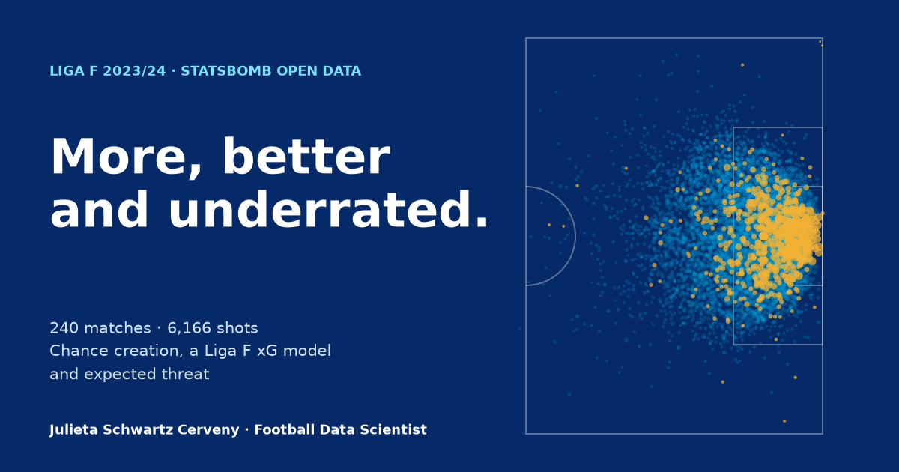

# More, better and underrated: Liga F 2023/24 in data

An in-depth analysis of the full 2023/24 Liga F season (240 matches, 6,166 shots), built from StatsBomb open event data. It covers how teams create chances, a Liga F expected-goals model, expected threat (xT), and player similarity.

**[Read the analysis →](https://juls1609.github.io/womens-football-analytics/)** · **[Explore the data →](https://juls1609.github.io/womens-football-analytics/explore.html)**



## Key findings

1. **The best teams don't create differently. They create more, and better.** The top four took 58% more non-penalty shots per match than the other twelve, each worth 33% more xG, with a chance mix within 5 percentage points of everyone else's. One principal component explains about 90% of the variation between teams and tracks points at r ≈ 0.95. Liga F is a ladder of control rather than a set of competing styles.
2. **Liga F outscores its xG, and it isn't luck.** 701 non-penalty goals against 612 StatsBomb xG (+89, z = 4.2). Almost all of the gap is on shots with no defender between ball and goal. A Liga F xG model trained with freeze-frame features and validated on unseen matches shows StatsBomb's model still *ranks* chances best (AUC 0.816 vs 0.810) but sets their *level* too low. Recalibrated to the league, it becomes the best model of the four tested, and Barcelona's "+26 finishing" shrinks to +6.
3. **Expected threat finds the creators assists miss.** xT and xA per 90 correlate at r = 0.78. Eight players rank in the top 25 for xT but outside the top 40 for xA, mostly defenders and ball-carriers.

## Methods at a glance

| Area | Approach |
|---|---|
| Data validation | Goals, shots and minutes reconcile with official match records, and the pipeline stops if they don't |
| Chance types | Rule-based categories using a 10-second set-piece window and StatsBomb's pass qualifiers |
| xG | Logistic regression and gradient boosting with freeze-frame features; 5-fold cross-validation grouped by match; calibration analysis; significance test of the goals-vs-xG gap |
| Possession value | Expected threat (Karun Singh's grid model) fitted on the season's open play |
| Team styles | Standardised PCA with sign alignment, K-means with silhouette score, and a sensitivity model without Barcelona |
| Player similarity | Cosine similarity on standardised per-90 profiles, with percentiles within position group |

Every definition and choice is explained in [`METHODOLOGY.md`](METHODOLOGY.md).

## Project structure

| Path | Contents |
|---|---|
| `src/download_liga_f.py` | Downloads the season from StatsBomb open data (resumable, one cached file per match) |
| `src/build_liga_f_metrics.py` | The main pipeline: validation, chance creation, minutes, passing, defending, styles and player profiles |
| `src/xg_model.py` | The xG gap analysis and the Liga F xG models |
| `src/expected_threat.py` | The expected threat model |
| `src/make_social_card.py` | Draws the preview image shown when the site is shared |
| `app/` | The static website: `index.html` (the analysis) and `explore.html` (the interactive dashboard) |

## Reproduce

```bash
python3 -m venv .venv
.venv/bin/pip install -r requirements.txt
.venv/bin/python src/download_liga_f.py        # ~1.7 GB of event data into data/
.venv/bin/python src/build_liga_f_metrics.py   # ~25 s; writes data/processed/ and app/data/
.venv/bin/python src/make_social_card.py
python3 -m http.server 8000 --directory app    # open http://localhost:8000
```

---

Julieta Schwartz Cerveny · Football Data Scientist · Data: [StatsBomb Open Data](https://github.com/statsbomb/open-data). Club crests remain the property of their respective owners.
